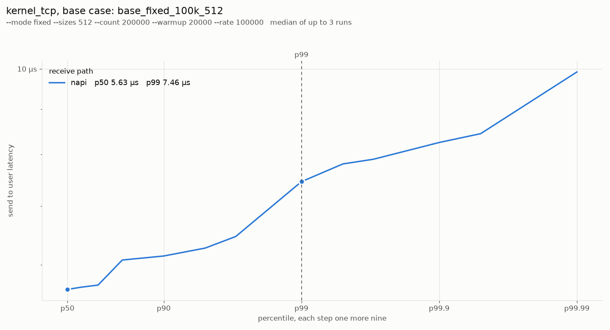
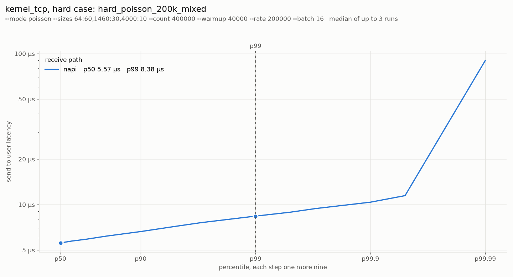
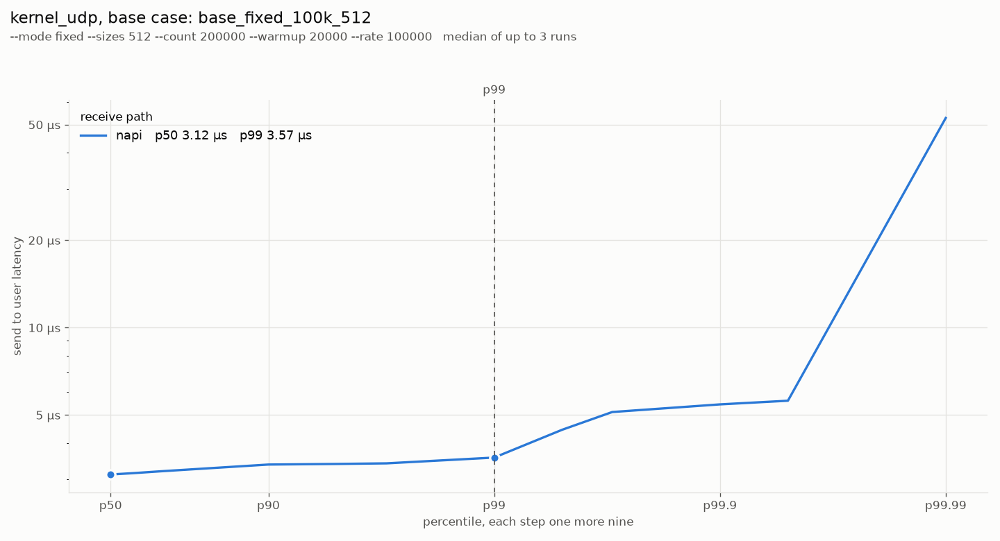
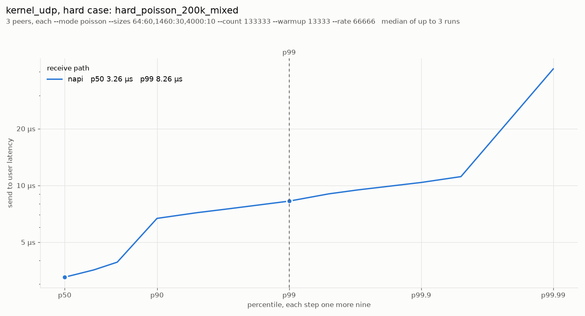

# Network benchmarks

_Generated by `tools/netbench`. Started 2026-10-25T19:28:46+00:00, 3 repetitions per variant, medians of the valid ones._

## Fingerprint

- `started`: 2026-10-25T19:28:46Z
- `commit`: b7fc0f8-dirty
- `host`: tallandstrongplatform
- `kernel`: 7.0.0-38-generic
- `cmdline`: BOOT_IMAGE=/vmlinuz-7.0.0-38-generic root=/dev/mapper/ubuntu--vg-ubuntu--lv ro irqaffinity=8-11 isolcpus=managed_irq,4-7 rcu_nocbs=4-7 crashkernel=2G-4G:320M,4G-32G:512M,32G-64G:1024M,64G-128G:2048M,128G-:4096M
- `cpu`: 13th Gen Intel(R) Core(TM) i7-1365U
- `load_before`: 1.59 0.71 0.30
- `exit_code`: 0

## Plots

## kernel_tcp

| Workload | Valid | p50 | p90 | p99 | p99.9 | max | k→u p50 | k→u p99 | msg/read | msg/s | lost |
| --- | --- | --- | --- | --- | --- | --- | --- | --- | --- | --- | --- |
| base_fixed_100k_512 | 3/3 | 5.63 µs | 6.14 µs | 7.46 µs | 8.26 µs | 73.15 µs | 3.71 µs | 4.45 µs | 1.0 | 100,000 |  |
| hard_poisson_200k_mixed | 3/3 | 5.57 µs | 6.62 µs | 8.38 µs | 10.37 µs | 364.70 µs | 3.58 µs | 5.73 µs | 1.2 | 200,006 |  |
| ack_64 | 3/3 | 6.01 µs | 6.21 µs | 9.54 µs | 12.22 µs | 34.84 µs | 3.90 µs | 7.36 µs | 1.0 | 86,660 |  |
| ack_1460 | 3/3 | 4.70 µs | 6.88 µs | 7.52 µs | 9.54 µs | 28.81 µs | 2.48 µs | 4.99 µs | 1.0 | 93,394 |  |
| poisson_100k_64 | 3/3 | 5.50 µs | 6.17 µs | 7.87 µs | 9.86 µs | 146.24 µs | 3.62 µs | 5.76 µs | 1.0 | 100,006 |  |
| burst_64x1k_64 | 3/3 | 5.44 µs | 7.87 µs | 11.39 µs | 21.76 µs | 22.22 µs | 2.62 µs | 6.24 µs | 64.0 | 64,029 |  |
| flood_1460 | 3/3 | 11.97 µs | 13.44 µs | 15.49 µs | 21.76 µs | 72.27 µs | 4.64 µs | 7.29 µs | 32.1 | 3,201,612 |  |

## kernel_udp

| Workload | Valid | p50 | p90 | p99 | p99.9 | max | k→u p50 | k→u p99 | msg/read | msg/s | lost |
| --- | --- | --- | --- | --- | --- | --- | --- | --- | --- | --- | --- |
| base_fixed_100k_512 | 3/3 | 3.12 µs | 3.38 µs | 3.57 µs | 5.44 µs | 144.96 µs | 2.03 µs | 2.37 µs | 1.0 | 100,000 |  |
| hard_poisson_200k_mixed | 3/3 | 3.26 µs | 6.69 µs | 8.26 µs | 10.37 µs | 147.99 µs | 2.17 µs | 4.77 µs | 1.2 | 199,714 |  |
| ack_64 | 3/3 | 3.52 µs | 3.62 µs | 4.22 µs | 6.05 µs | 23.17 µs | 2.30 µs | 2.59 µs | 1.0 | 113,559 |  |
| ack_1460 | 3/3 | 3.62 µs | 3.69 µs | 5.05 µs | 6.33 µs | 53.09 µs | 2.27 µs | 2.90 µs | 1.0 | 111,091 |  |
| poisson_100k_64 | 3/3 | 2.96 µs | 3.23 µs | 3.52 µs | 5.41 µs | 145.36 µs | 1.97 µs | 2.35 µs | 1.0 | 100,006 |  |
| burst_64x1k_64 | 3/3 | 5.70 µs | 8.77 µs | 11.01 µs | 13.05 µs | 21.77 µs | 4.70 µs | 9.98 µs | 5.6 | 63,962 |  |
| flood_1460 | 3/3 | 16.51 µs | 27.52 µs | 31.49 µs | 35.33 µs | 95.78 µs | 15.29 µs | 30.34 µs | 25.1 | 1,158,789 | 0.01% |

## Workloads

- base_fixed_100k_512: `--mode fixed --sizes 512 --count 200000 --warmup 20000 --rate 100000`
- hard_poisson_200k_mixed
    - kernel_tcp: `--mode poisson --sizes 64:60,1460:30,4000:10 --count 400000 --warmup 40000 --rate 200000 --batch 16`
    - kernel_udp: `3 peers, each --mode poisson --sizes 64:60,1460:30,4000:10 --count 133333 --warmup 13333 --rate 66666`
- ack_64: `--mode ack --sizes 64 --count 20000 --warmup 2000`
- ack_1460: `--mode ack --sizes 1460 --count 20000 --warmup 2000`
- poisson_100k_64: `--mode poisson --sizes 64 --count 100000 --warmup 10000 --rate 100000`
- burst_64x1k_64
    - kernel_tcp: `--mode burst --sizes 64 --count 128000 --warmup 12800 --rate 1000 --burst 64 --batch 64`
    - kernel_udp: `3 peers, each --mode burst --sizes 64 --count 42666 --warmup 4266 --rate 333 --burst 64`
- flood_1460
    - kernel_tcp: `--mode flood --sizes 1460 --count 600000 --warmup 60000 --batch 32`
    - kernel_udp: `3 peers, each --mode flood --sizes 1460 --count 200000 --warmup 20000`
