# Network benchmarks

_Generated by `tools/netbench`. Started 2026-10-26T20:29:18+00:00, 3 repetitions per variant, medians of the valid ones._

## Fingerprint

- `started`: 2026-10-26T20:29:18Z
- `commit`: a674c13-dirty
- `host`: tallandstrongplatform
- `kernel`: 7.0.0-38-generic
- `cmdline`: BOOT_IMAGE=/vmlinuz-7.0.0-38-generic root=/dev/mapper/ubuntu--vg-ubuntu--lv ro irqaffinity=8-11 isolcpus=managed_irq,4-7 rcu_nocbs=4-7 crashkernel=2G-4G:320M,4G-32G:512M,32G-64G:1024M,64G-128G:2048M,128G-:4096M
- `cpu`: 13th Gen Intel(R) Core(TM) i7-1365U
- `load_before`: 2.17 1.34 0.58
- `exit_code`: 0

## Receive

### Plots

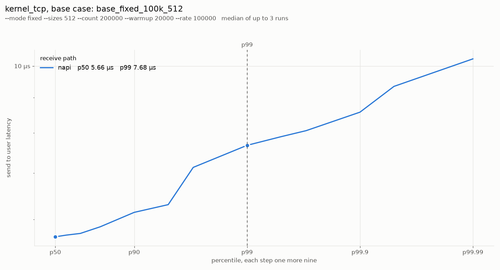
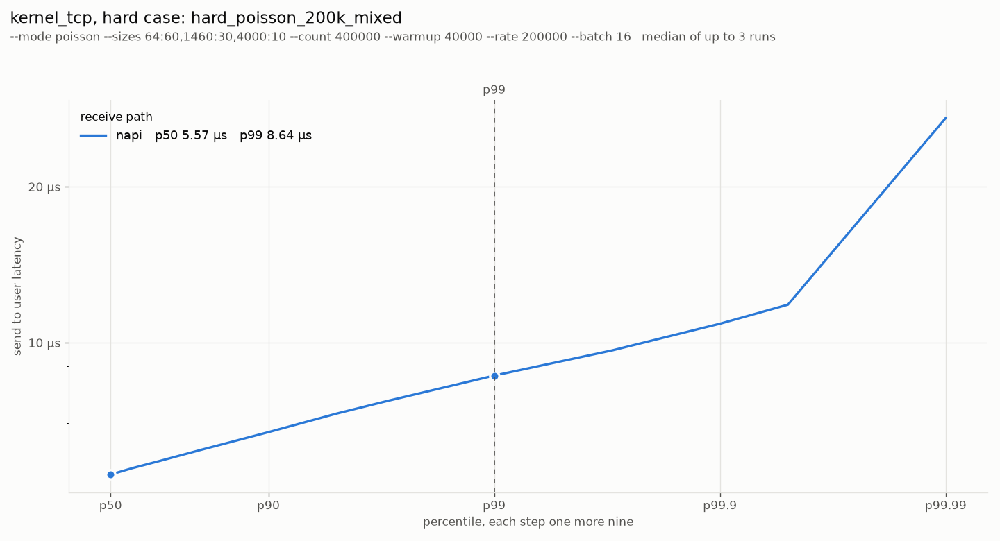
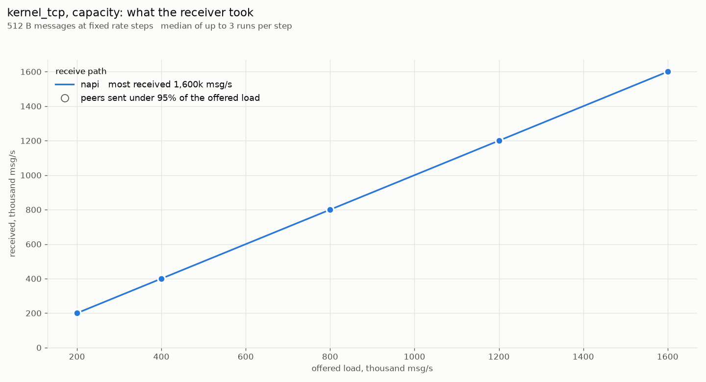
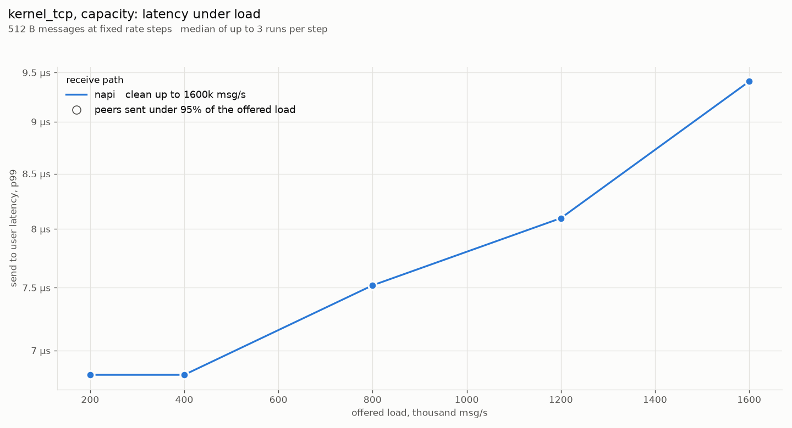
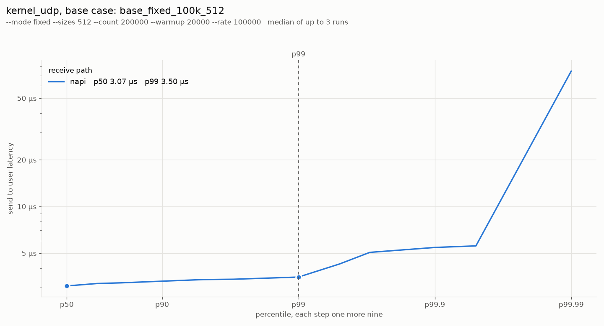
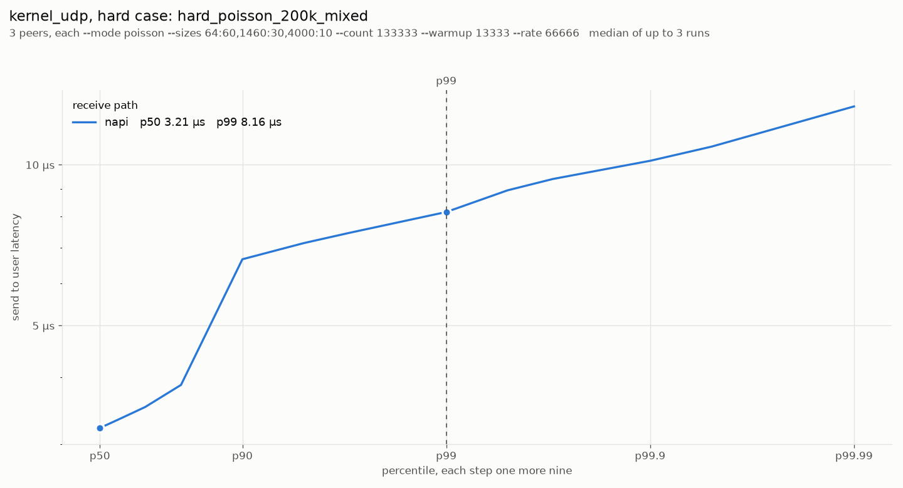
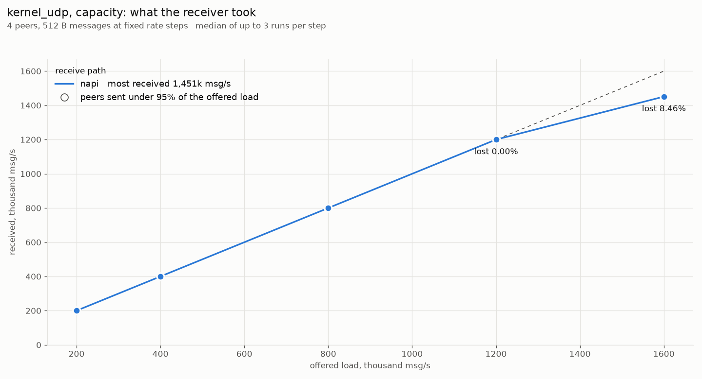
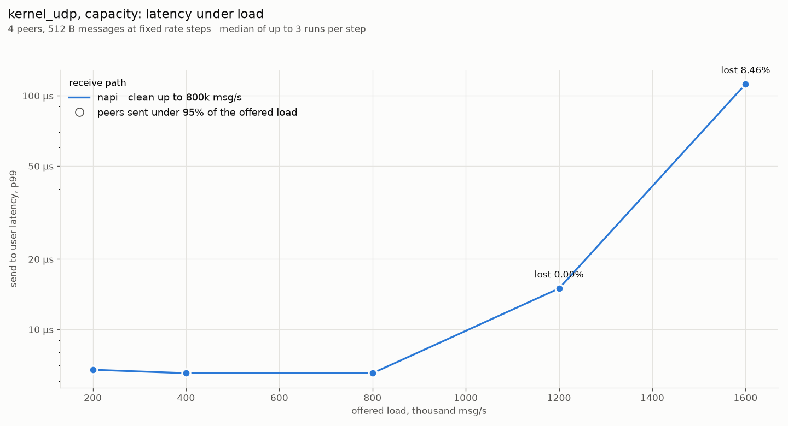

### kernel_tcp

| Workload | Valid | p50 | p90 | p99 | p99.9 | max | k→u p50 | k→u p99 | msg/read | sent/s | recv/s | recv MB/s | lost |
| --- | --- | --- | --- | --- | --- | --- | --- | --- | --- | --- | --- | --- | --- |
| base_fixed_100k_512 | 3/3 | 5.66 µs | 6.14 µs | 7.68 µs | 8.57 µs | 35.32 µs | 3.73 µs | 5.50 µs | 1.0 | 100,000 | 100,001 | 51 |  |
| hard_poisson_200k_mixed | 3/3 | 5.57 µs | 6.72 µs | 8.64 µs | 10.88 µs | 265.54 µs | 3.58 µs | 5.98 µs | 1.2 | 200,006 | 200,182 | 175 |  |
| ack_64 | 3/3 | 6.08 µs | 6.59 µs | 9.60 µs | 12.48 µs | 42.11 µs | 3.97 µs | 7.42 µs | 1.0 | 86,353 | 86,405 | 6 |  |
| ack_1460 | 3/3 | 4.77 µs | 6.91 µs | 8.10 µs | 9.41 µs | 21.61 µs | 2.54 µs | 4.99 µs | 1.0 | 92,735 | 92,945 | 136 |  |
| poisson_100k_64 | 3/3 | 5.47 µs | 6.21 µs | 8.06 µs | 10.18 µs | 68.55 µs | 3.62 µs | 5.89 µs | 1.0 | 100,006 | 100,059 | 6 |  |
| burst_64x1k_64 | 3/3 | 5.57 µs | 8.03 µs | 11.33 µs | 20.22 µs | 20.50 µs | 2.69 µs | 6.14 µs | 64.0 | 64,029 | 64,032 | 4 |  |
| flood_1460 | 3/3 | 12.03 µs | 13.82 µs | 15.62 µs | 23.81 µs | 72.22 µs | 4.67 µs | 7.33 µs | 32.2 | 3,202,846 | 3,208,547 | 4,684 |  |
| load_200k_512 | 3/3 | 5.21 µs | 5.34 µs | 6.82 µs | 7.84 µs | 163.19 µs | 3.54 µs | 4.58 µs | 1.0 | 200,000 | 200,001 | 102 |  |
| load_400k_512 | 3/3 | 4.19 µs | 4.83 µs | 6.82 µs | 8.38 µs | 181.89 µs | 2.51 µs | 4.25 µs | 1.3 | 400,000 | 400,001 | 205 |  |
| load_800k_512 | 3/3 | 4.80 µs | 5.41 µs | 7.52 µs | 9.09 µs | 187.23 µs | 2.94 µs | 5.02 µs | 2.9 | 799,998 | 800,001 | 410 |  |
| load_1200k_512 | 3/3 | 4.89 µs | 6.50 µs | 8.10 µs | 9.60 µs | 165.02 µs | 3.02 µs | 5.50 µs | 4.5 | 1,199,998 | 1,199,999 | 614 |  |
| load_1600k_512 | 3/3 | 5.31 µs | 7.62 µs | 9.41 µs | 12.29 µs | 209.26 µs | 3.29 µs | 5.95 µs | 6.2 | 1,599,996 | 1,600,001 | 819 |  |
| bulk_16k | 3/3 | 23.04 µs | 26.11 µs | 27.90 µs | 30.21 µs | 88.20 µs | 7.46 µs | 10.43 µs | 2.7 | 393,051 | 395,250 | 6,476 |  |
| bulk_64k | 3/3 | 51.71 µs | 76.29 µs | 84.99 µs | 164.86 µs | 283.31 µs | 12.48 µs | 19.33 µs | 1.3 | 113,030 | 114,058 | 7,414 |  |

### kernel_udp

| Workload | Valid | p50 | p90 | p99 | p99.9 | max | k→u p50 | k→u p99 | msg/read | sent/s | recv/s | recv MB/s | lost |
| --- | --- | --- | --- | --- | --- | --- | --- | --- | --- | --- | --- | --- | --- |
| base_fixed_100k_512 | 3/3 | 3.07 µs | 3.29 µs | 3.50 µs | 5.44 µs | 194.74 µs | 2.03 µs | 2.38 µs | 1.0 | 100,000 | 100,001 | 51 |  |
| hard_poisson_200k_mixed | 3/3 | 3.21 µs | 6.66 µs | 8.16 µs | 10.18 µs | 31.10 µs | 2.14 µs | 4.70 µs | 1.2 | 199,714 | 199,537 | 175 |  |
| ack_64 | 3/3 | 3.47 µs | 3.54 µs | 3.92 µs | 5.89 µs | 37.83 µs | 2.24 µs | 2.50 µs | 1.0 | 115,433 | 114,894 | 7 |  |
| ack_1460 | 3/3 | 3.65 µs | 3.73 µs | 4.22 µs | 6.21 µs | 24.91 µs | 2.33 µs | 2.67 µs | 1.0 | 110,932 | 110,972 | 162 |  |
| poisson_100k_64 | 3/3 | 2.93 µs | 3.20 µs | 3.42 µs | 5.25 µs | 139.63 µs | 1.95 µs | 2.29 µs | 1.0 | 100,006 | 100,059 | 6 |  |
| burst_64x1k_64 | 3/3 | 5.89 µs | 8.96 µs | 11.33 µs | 14.08 µs | 23.16 µs | 4.86 µs | 10.30 µs | 6.7 | 63,962 | 63,905 | 4 |  |
| flood_1460 | 3/3 | 16.89 µs | 27.65 µs | 30.59 µs | 32.00 µs | 44.29 µs | 15.68 µs | 29.44 µs | 28.6 | 1,181,680 | 1,172,869 | 1,712 |  |
| load_200k_512 | 3/3 | 4.80 µs | 4.99 µs | 6.72 µs | 7.36 µs | 141.96 µs | 3.89 µs | 5.79 µs | 4.0 | 200,002 | 200,003 | 102 |  |
| load_400k_512 | 3/3 | 4.86 µs | 5.02 µs | 6.50 µs | 7.23 µs | 36.83 µs | 3.95 µs | 5.63 µs | 4.0 | 400,002 | 400,002 | 205 |  |
| load_800k_512 | 3/3 | 4.83 µs | 5.02 µs | 6.50 µs | 9.79 µs | 154.61 µs | 3.94 µs | 5.60 µs | 4.0 | 800,001 | 800,002 | 410 |  |
| load_1200k_512 | 3/3 | 4.99 µs | 8.32 µs | 14.97 µs | 26.50 µs | 160.27 µs | 4.08 µs | 14.02 µs | 5.6 | 1,200,000 | 1,199,981 | 614 | 0.00% |
| load_1600k_512 | 3/3 | 99.33 µs | 108.54 µs | 112.13 µs | 115.20 µs | 248.06 µs | 98.30 µs | 111.61 µs | 32.0 | 1,600,000 | 1,451,063 | 743 | 8.46% |

### Workloads

- base_fixed_100k_512: `--mode fixed --sizes 512 --count 200000 --warmup 20000 --rate 100000`
- hard_poisson_200k_mixed
    - kernel_tcp: `--mode poisson --sizes 64:60,1460:30,4000:10 --count 400000 --warmup 40000 --rate 200000 --batch 16`
    - kernel_udp: `3 peers, each --mode poisson --sizes 64:60,1460:30,4000:10 --count 133333 --warmup 13333 --rate 66666`
- ack_64: `--mode ack --sizes 64 --count 20000 --warmup 2000`
- ack_1460: `--mode ack --sizes 1460 --count 20000 --warmup 2000`
- poisson_100k_64: `--mode poisson --sizes 64 --count 100000 --warmup 10000 --rate 100000`
- burst_64x1k_64
    - kernel_tcp: `--mode burst --sizes 64 --count 128000 --warmup 12800 --rate 1000 --burst 64 --batch 64`
    - kernel_udp: `3 peers, each --mode burst --sizes 64 --count 42666 --warmup 4266 --rate 333 --burst 64`
- flood_1460
    - kernel_tcp: `--mode flood --sizes 1460 --count 600000 --warmup 60000 --batch 32`
    - kernel_udp: `3 peers, each --mode flood --sizes 1460 --count 200000 --warmup 20000`
- load_200k_512
    - kernel_tcp: `--mode fixed --sizes 512 --count 300000 --warmup 30000 --rate 200000 --batch 32`
    - kernel_udp: `4 peers, each --mode fixed --sizes 512 --count 75000 --warmup 7500 --rate 50000`
- load_400k_512
    - kernel_tcp: `--mode fixed --sizes 512 --count 600000 --warmup 60000 --rate 400000 --batch 32`
    - kernel_udp: `4 peers, each --mode fixed --sizes 512 --count 150000 --warmup 15000 --rate 100000`
- load_800k_512
    - kernel_tcp: `--mode fixed --sizes 512 --count 1200000 --warmup 120000 --rate 800000 --batch 32`
    - kernel_udp: `4 peers, each --mode fixed --sizes 512 --count 300000 --warmup 30000 --rate 200000`
- load_1200k_512
    - kernel_tcp: `--mode fixed --sizes 512 --count 1800000 --warmup 180000 --rate 1200000 --batch 32`
    - kernel_udp: `4 peers, each --mode fixed --sizes 512 --count 450000 --warmup 45000 --rate 300000`
- load_1600k_512
    - kernel_tcp: `--mode fixed --sizes 512 --count 2400000 --warmup 240000 --rate 1600000 --batch 32`
    - kernel_udp: `4 peers, each --mode fixed --sizes 512 --count 600000 --warmup 60000 --rate 400000`
- bulk_16k: `--mode flood --sizes 16384 --count 200000 --warmup 20000 --batch 8`
- bulk_64k: `--mode flood --sizes 65000 --count 50000 --warmup 5000 --batch 8`

## Send

### Plots

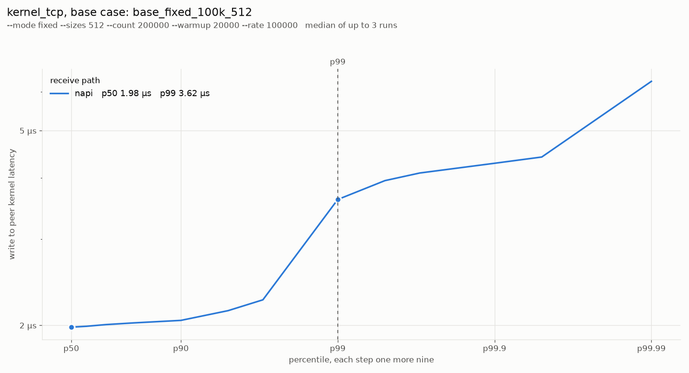
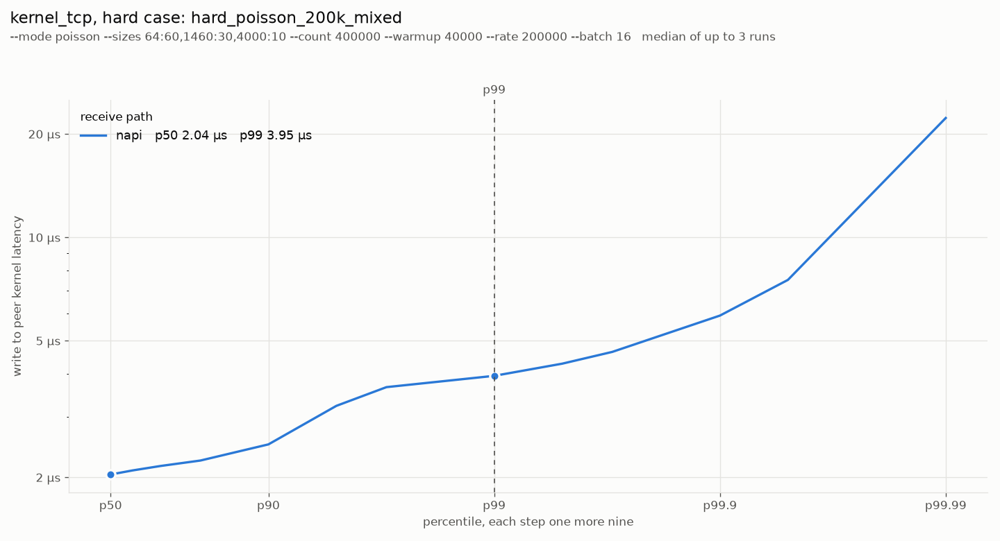
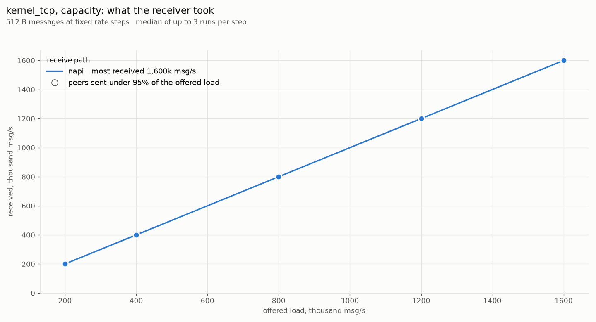
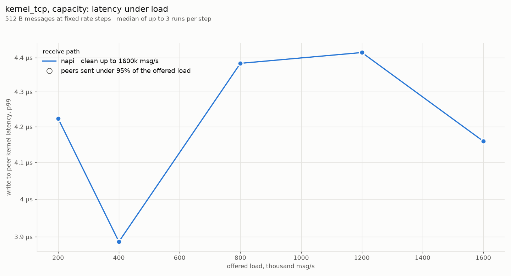
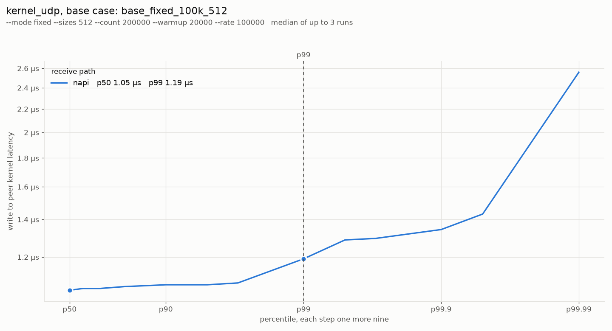
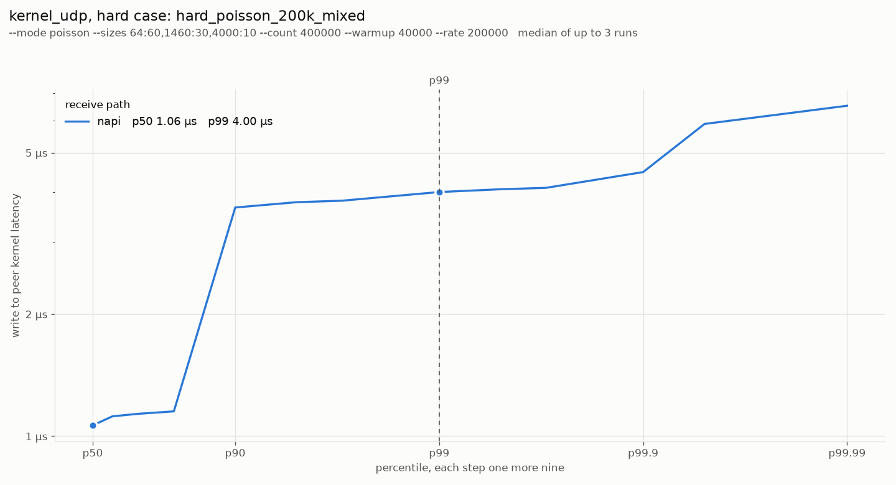
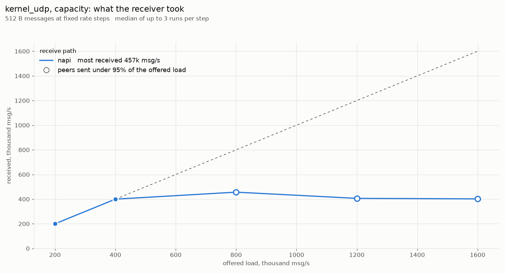
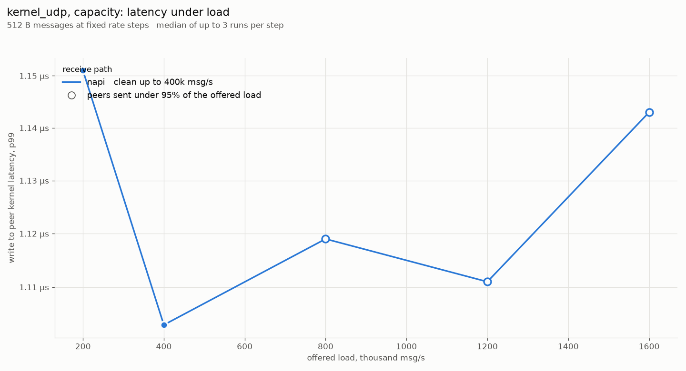

### kernel_tcp

| Workload | Valid | p50 | p90 | p99 | p99.9 | max | write p50 | write p99 | msg/read | sent/s | recv/s | recv MB/s | lost |
| --- | --- | --- | --- | --- | --- | --- | --- | --- | --- | --- | --- | --- | --- |
| base_fixed_100k_512 | 3/3 | 1.98 µs | 2.05 µs | 3.62 µs | 4.29 µs | 21.95 µs | 3.18 µs | 4.99 µs | 1.0 | 100,000 | 100,000 | 51 |  |
| hard_poisson_200k_mixed | 3/3 | 2.04 µs | 2.50 µs | 3.95 µs | 5.92 µs | 116.75 µs | 3.76 µs | 5.82 µs | 1.2 | 200,006 | 200,182 | 175 |  |
| ack_64 | 3/3 | 2.17 µs | 2.25 µs | 5.79 µs | 7.65 µs | 21.39 µs | 3.55 µs | 7.23 µs | 1.0 | 86,031 | 85,758 | 5 |  |
| ack_1460 | 3/3 | 2.24 µs | 2.51 µs | 3.92 µs | 5.54 µs | 13.69 µs | 5.54 µs | 9.28 µs | 1.0 | 93,322 | 93,726 | 137 |  |
| poisson_100k_64 | 3/3 | 1.95 µs | 2.13 µs | 3.07 µs | 5.41 µs | 15.24 µs | 3.33 µs | 5.21 µs | 1.0 | 100,006 | 100,059 | 6 |  |
| burst_64x1k_64 | 3/3 | 2.91 µs | 4.67 µs | 6.72 µs | 11.46 µs | 14.19 µs | 6.08 µs | 12.41 µs | 64.0 | 64,029 | 64,032 | 4 |  |
| flood_1460 | 3/3 | 6.69 µs | 7.68 µs | 9.21 µs | 14.02 µs | 37.87 µs | 9.79 µs | 13.12 µs | 32.0 | 3,211,204 | 3,224,971 | 4,708 |  |
| load_200k_512 | 3/3 | 2.04 µs | 2.11 µs | 4.22 µs | 4.64 µs | 53.39 µs | 3.25 µs | 5.47 µs | 1.0 | 200,000 | 200,001 | 102 |  |
| load_400k_512 | 3/3 | 1.74 µs | 2.73 µs | 3.89 µs | 5.21 µs | 82.65 µs | 3.33 µs | 5.89 µs | 1.4 | 399,999 | 400,000 | 205 |  |
| load_800k_512 | 3/3 | 2.16 µs | 2.83 µs | 4.38 µs | 5.34 µs | 92.92 µs | 4.19 µs | 6.43 µs | 3.5 | 799,997 | 800,001 | 410 |  |
| load_1200k_512 | 3/3 | 2.24 µs | 2.86 µs | 4.42 µs | 5.98 µs | 109.81 µs | 4.13 µs | 6.72 µs | 5.0 | 1,199,996 | 1,200,000 | 614 |  |
| load_1600k_512 | 3/3 | 1.94 µs | 3.68 µs | 4.16 µs | 5.92 µs | 22.72 µs | 4.09 µs | 6.88 µs | 6.6 | 1,599,993 | 1,600,002 | 819 |  |
| bulk_16k | 3/3 | 17.66 µs | 20.61 µs | 21.25 µs | 23.42 µs | 60.81 µs | 23.93 µs | 26.88 µs | 2.7 | 332,600 | 333,441 | 5,463 |  |
| bulk_64k | 3/3 | 44.29 µs | 74.24 µs | 79.87 µs | 84.99 µs | 151.25 µs | 82.94 µs | 93.69 µs | 1.0 | 95,636 | 95,980 | 6,239 |  |

### kernel_udp

| Workload | Valid | p50 | p90 | p99 | p99.9 | max | write p50 | write p99 | msg/read | sent/s | recv/s | recv MB/s | lost |
| --- | --- | --- | --- | --- | --- | --- | --- | --- | --- | --- | --- | --- | --- |
| base_fixed_100k_512 | 3/3 | 1.05 µs | 1.07 µs | 1.19 µs | 1.34 µs | 10.52 µs | 2.37 µs | 2.75 µs | 1.0 | 100,000 | 100,000 | 51 |  |
| hard_poisson_200k_mixed | 3/3 | 1.06 µs | 3.66 µs | 4.00 µs | 4.48 µs | 15.48 µs | 2.42 µs | 5.66 µs | 1.0 | 200,006 | 200,182 | 175 |  |
| ack_64 | 3/3 | 1.23 µs | 1.25 µs | 1.42 µs | 3.20 µs | 11.24 µs | 2.75 µs | 3.12 µs | 1.0 | 118,431 | 118,480 | 8 |  |
| ack_1460 | 3/3 | 1.33 µs | 1.36 µs | 1.51 µs | 3.44 µs | 9.94 µs | 2.85 µs | 3.17 µs | 1.0 | 118,368 | 119,039 | 174 |  |
| poisson_100k_64 | 3/3 | 991 ns | 1.01 µs | 1.22 µs | 2.46 µs | 11.60 µs | 2.29 µs | 2.72 µs | 1.0 | 100,006 | 100,059 | 6 |  |
| burst_64x1k_64 | 3/3 | 991 ns | 1.01 µs | 1.23 µs | 1.30 µs | 9.44 µs | 2.30 µs | 2.69 µs | 1.0 | 64,025 | 64,027 | 4 |  |
| flood_1460 | 3/3 | 1.11 µs | 1.13 µs | 1.14 µs | 2.67 µs | 7.08 µs | 2.42 µs | 2.53 µs | 1.0 | 407,908 | 408,061 | 596 |  |
| load_200k_512 | 3/3 | 1.06 µs | 1.10 µs | 1.15 µs | 2.64 µs | 13.37 µs | 2.40 µs | 2.99 µs | 1.0 | 200,000 | 200,001 | 102 |  |
| load_400k_512 | 3/3 | 1.05 µs | 1.08 µs | 1.10 µs | 2.96 µs | 8.96 µs | 2.38 µs | 2.58 µs | 1.0 | 400,000 | 400,001 | 205 |  |
| load_800k_512 | 3/3 | 931 ns | 1.08 µs | 1.12 µs | 2.85 µs | 13.22 µs | 2.06 µs | 2.54 µs | 1.0 | 451,028 | 456,595 | 234 |  |
| load_1200k_512 | 3/3 | 1.06 µs | 1.09 µs | 1.11 µs | 2.94 µs | 14.23 µs | 2.40 µs | 2.54 µs | 1.0 | 406,448 | 406,191 | 208 |  |
| load_1600k_512 | 3/3 | 1.09 µs | 1.13 µs | 1.14 µs | 2.96 µs | 16.11 µs | 2.42 µs | 2.59 µs | 1.0 | 401,988 | 402,071 | 206 |  |

### Workloads

- base_fixed_100k_512: `--mode fixed --sizes 512 --count 200000 --warmup 20000 --rate 100000`
- hard_poisson_200k_mixed
    - kernel_tcp: `--mode poisson --sizes 64:60,1460:30,4000:10 --count 400000 --warmup 40000 --rate 200000 --batch 16`
    - kernel_udp: `--mode poisson --sizes 64:60,1460:30,4000:10 --count 400000 --warmup 40000 --rate 200000`
- ack_64: `--mode ack --sizes 64 --count 20000 --warmup 2000`
- ack_1460: `--mode ack --sizes 1460 --count 20000 --warmup 2000`
- poisson_100k_64: `--mode poisson --sizes 64 --count 100000 --warmup 10000 --rate 100000`
- burst_64x1k_64
    - kernel_tcp: `--mode burst --sizes 64 --count 128000 --warmup 12800 --rate 1000 --burst 64 --batch 64`
    - kernel_udp: `--mode burst --sizes 64 --count 128000 --warmup 12800 --rate 1000 --burst 64`
- flood_1460
    - kernel_tcp: `--mode flood --sizes 1460 --count 600000 --warmup 60000 --batch 32`
    - kernel_udp: `--mode flood --sizes 1460 --count 600000 --warmup 60000`
- load_200k_512
    - kernel_tcp: `--mode fixed --sizes 512 --count 300000 --warmup 30000 --rate 200000 --batch 32`
    - kernel_udp: `--mode fixed --sizes 512 --count 300000 --warmup 30000 --rate 200000`
- load_400k_512
    - kernel_tcp: `--mode fixed --sizes 512 --count 600000 --warmup 60000 --rate 400000 --batch 32`
    - kernel_udp: `--mode fixed --sizes 512 --count 600000 --warmup 60000 --rate 400000`
- load_800k_512
    - kernel_tcp: `--mode fixed --sizes 512 --count 1200000 --warmup 120000 --rate 800000 --batch 32`
    - kernel_udp: `--mode fixed --sizes 512 --count 1200000 --warmup 120000 --rate 800000`
- load_1200k_512
    - kernel_tcp: `--mode fixed --sizes 512 --count 1800000 --warmup 180000 --rate 1200000 --batch 32`
    - kernel_udp: `--mode fixed --sizes 512 --count 1800000 --warmup 180000 --rate 1200000`
- load_1600k_512
    - kernel_tcp: `--mode fixed --sizes 512 --count 2400000 --warmup 240000 --rate 1600000 --batch 32`
    - kernel_udp: `--mode fixed --sizes 512 --count 2400000 --warmup 240000 --rate 1600000`
- bulk_16k: `--mode flood --sizes 16384 --count 200000 --warmup 20000 --batch 8`
- bulk_64k: `--mode flood --sizes 65000 --count 50000 --warmup 5000 --batch 8`
